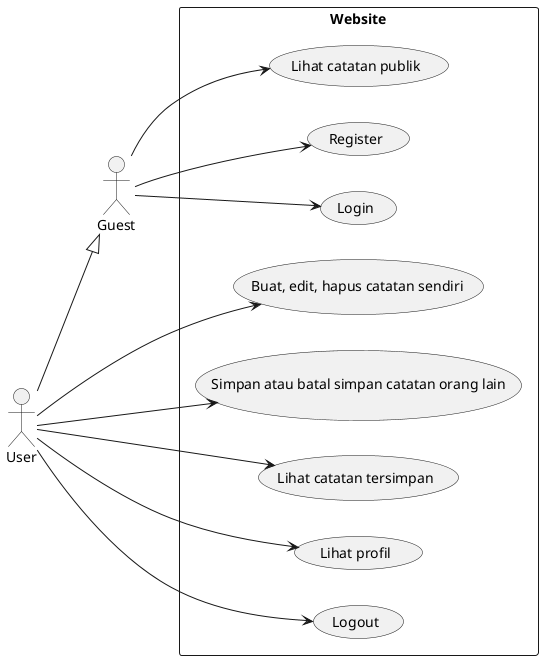
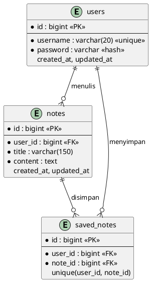
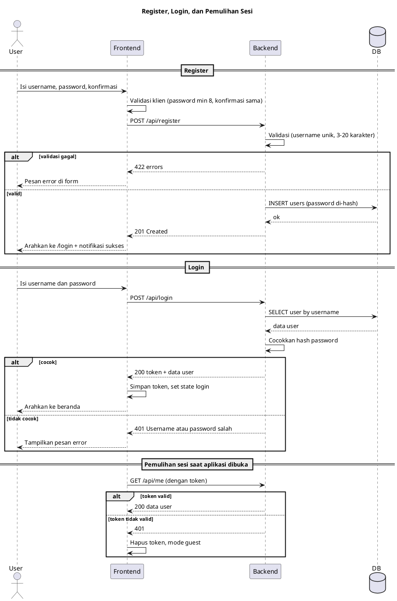
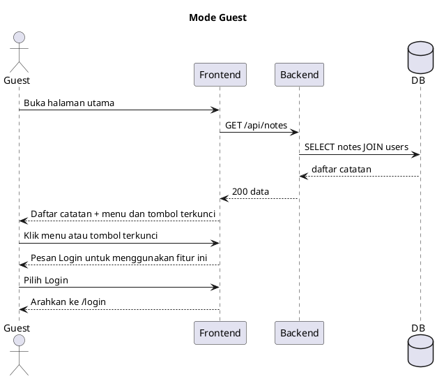
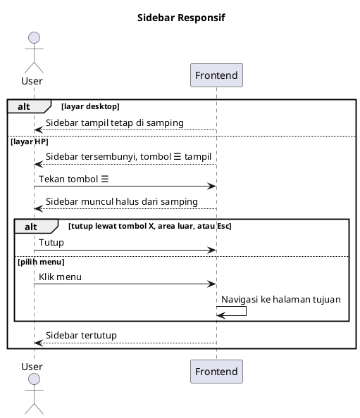
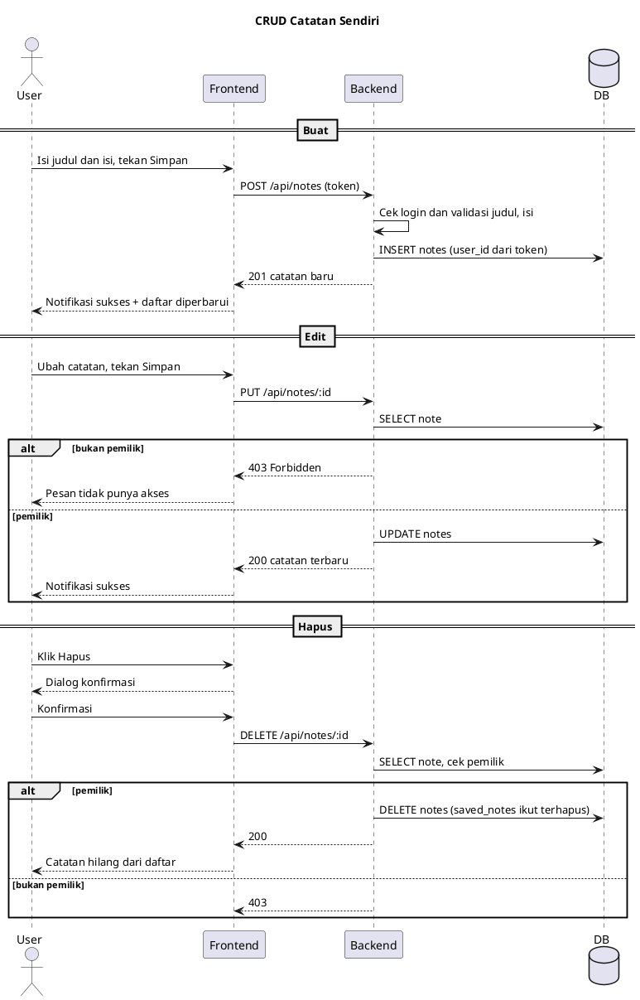
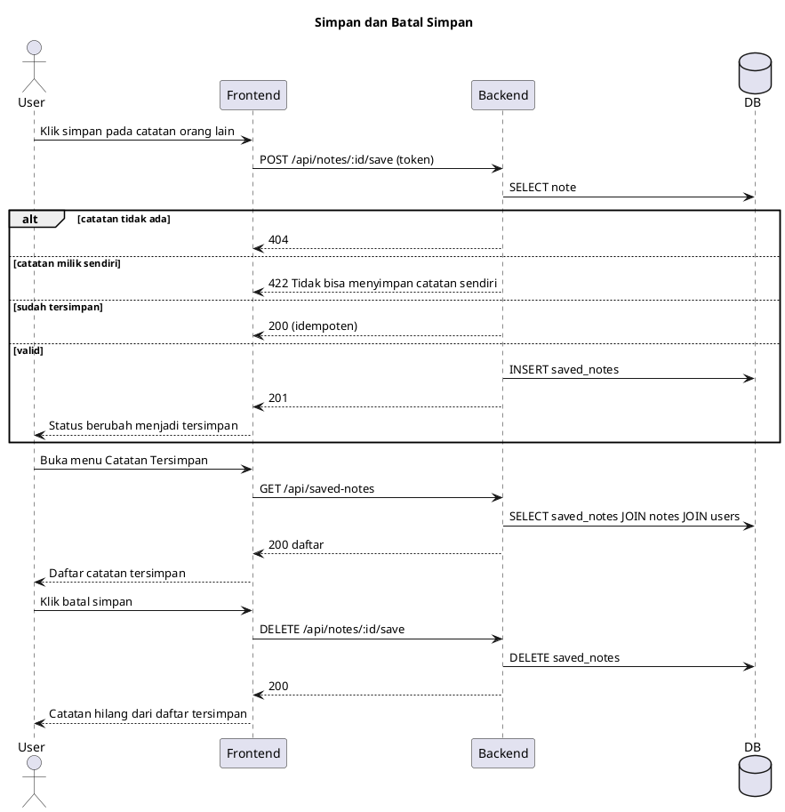
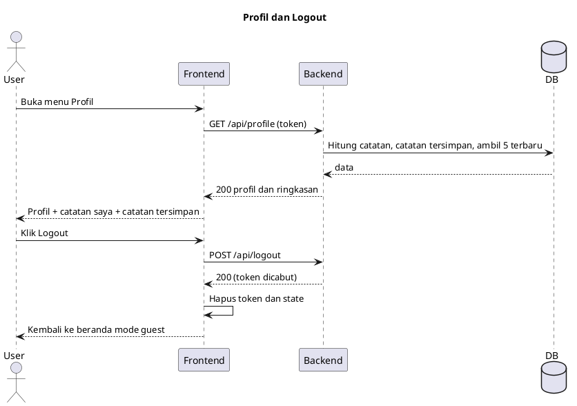

# Website Catatan Sosial (MVP)

Aplikasi catatan sosial sederhana. Guest bisa membaca catatan publik, sedangkan user yang login bisa menulis catatannya sendiri, menyimpan catatan orang lain, dan memiliki profil.

> **Status:** Draft v1.0 · 22 Oktober 2026

## Daftar Isi

1. [Instruksi untuk AI Agent](#1-instruksi-untuk-ai-agent)
2. [Ruang Lingkup MVP](#2-ruang-lingkup-mvp)
3. [Styling](#3-styling)
4. [Rancangan Sistem](#4-rancangan-sistem)
5. [Alur Sistem (Sequence Diagram)](#5-alur-sistem-sequence-diagram)
6. [Alur Pengerjaan dan Prompt](#6-alur-pengerjaan-dan-prompt)
7. [Checklist dan Keputusan Terbuka](#7-checklist-dan-keputusan-terbuka)

---

## 1. Instruksi untuk AI Agent

- Kerjakan **satu tahap per sesi** sesuai urutan di [bagian 6](#6-alur-pengerjaan-dan-prompt). Jangan menambah fitur di luar MVP.
- **Kontrak API di bagian 4.4 tidak boleh diubah** (path, method, kode status, format response).
- **Styling dasar di bagian 3 wajib diikuti** (palet warna, font, gaya glassmorphism).
- **Animasi, tata letak halaman, dan desain visual tidak diatur di dokumen ini.** Keputusan itu sepenuhnya diserahkan ke skill desain milik agent. Satu-satunya persyaratan perilaku: sidebar tetap di desktop dan menjadi tombol ☰ dengan drawer yang muncul halus dari samping di HP.
- Password selalu di-hash, secret hanya lewat `.env`, isi catatan ditampilkan sebagai teks (cegah XSS).
- Setelah tiap tahap, laporkan: file yang berubah, cara menjalankan, langkah uji manual, dan hal yang belum selesai.

---

## 2. Ruang Lingkup MVP

### 2.1 Asumsi (perlu dikonfirmasi)

1. Semua catatan bersifat **publik** (bisa dilihat guest dan user lain).
2. Hanya **pemilik** yang boleh mengedit dan menghapus catatan.
3. "Simpan" berarti **bookmark**, bukan menyalin catatan.
4. Auto save, export PDF, dan dark/light mode tidak ada di user story ini, jadi masuk setelah MVP.

### 2.2 User Story

| ID | Sebagai | Saya ingin | Kriteria penerimaan |
|---|---|---|---|
| US-01 | Guest | Melihat catatan orang lain di halaman utama | Daftar catatan publik tampil tanpa login, detail bisa dibuka |
| US-02 | Guest | Melihat fitur yang ada | Semua menu dan tombol aksi tampil tetapi terkunci, klik mengarahkan ke login |
| US-03 | Guest | Register dengan username, password, konfirmasi password | Username unik 3-20 karakter, password min 8, konfirmasi harus sama |
| US-04 | Guest | Login dengan username dan password | Berhasil menuju beranda, gagal menampilkan pesan generik |
| US-05 | User | Sidebar yang responsif | Desktop: sidebar tetap. HP: tombol ☰, drawer muncul halus dari samping |
| US-06 | User | Membuat, melihat, mengedit, menghapus catatan sendiri | CRUD berjalan, hapus meminta konfirmasi, hanya pemilik yang bisa ubah |
| US-07 | User | Melihat catatan orang lain lewat menu sidebar | Menu Beranda menampilkan catatan semua user |
| US-08 | User | Menyimpan catatan orang lain | Bisa simpan dan batal simpan, tidak bisa simpan catatan sendiri atau dobel |
| US-09 | User | Melihat profil, catatan tersimpan, dan catatan buatan saya | Data sesuai akun yang login |
| US-10 | User | Logout | Sesi dihapus, kembali ke mode guest |

### 2.3 Cakupan

**Masuk MVP:** register, login, logout, beranda publik, mode guest terkunci, sidebar responsif, CRUD catatan sendiri, detail catatan, simpan dan batal simpan, halaman tersimpan, profil.

**Setelah MVP:** auto save, export PDF, dark/light mode, catatan privat (`is_public`), pencarian, edit profil dan ganti password.

### 2.4 Menu Sidebar

- **User login:** Beranda · Catatan Saya · Catatan Tersimpan · Profil · Logout
- **Guest:** menu yang sama tampil tetapi terkunci (disertai Login/Register)

---

## 3. Styling

Bagian ini hanya mengatur identitas visual dasar. Penerapannya di komponen, animasi, dan layout diserahkan ke agent.

### 3.1 Palet Warna

| Nama | Hex | Peran |
|---|---|---|
| Mint | `#E0F8C7` | Latar terang, ujung gradien, permukaan |
| Lime | `#B7D894` | Gradien, border aksen, chip dan label |
| Sage | `#91AC67` | Ikon, hover sekunder, garis pemisah |
| Green | `#1DB954` | Warna utama: tombol aksi utama, link aktif, fokus |

Warna turunan (usulan): **Ink** `#17240F` untuk teks utama, **Ink Soft** `#3F5230` untuk teks sekunder, **Danger** `#D64545` untuk hapus dan error.

> **Kontras:** teks putih di atas `#1DB954` hanya sekitar 2,6:1 (di bawah standar 4,5:1). Gunakan teks Ink gelap pada tombol hijau, dan selalu Ink untuk teks di atas kaca.

### 3.2 Tipografi

| Peran | Font | Bobot | Dipakai untuk |
|---|---|---|---|
| Judul | **Bitter** | 600, 700 | Hero, H1-H3, judul catatan, judul kartu |
| Umum | **Poppins** | 400, 500, 600 | Isi catatan, sidebar, tombol, form, label, navigasi |

Bitter (slab serif) memberi karakter buku catatan yang hangat, sedangkan Poppins geometris dan jelas di ukuran kecil. Impor dari Google Fonts dengan `display=swap`. Teks isi: 15-16px, line-height 1.7.

### 3.3 Glassmorphism

```css
:root {
  --mint:#E0F8C7; --lime:#B7D894; --sage:#91AC67; --green:#1DB954;
  --ink:#17240F; --ink-soft:#3F5230; --danger:#D64545;
  --glass-bg:rgba(255,255,255,.42); --glass-border:rgba(255,255,255,.6);
  --glass-blur:16px; --radius:20px;
  --shadow:0 8px 32px rgba(23,36,15,.12);
  --font-head:'Bitter',serif; --font-body:'Poppins',sans-serif;
}
body {
  font-family:var(--font-body); color:var(--ink);
  background:
    radial-gradient(circle at 15% 10%, var(--green) 0, transparent 35%),
    radial-gradient(circle at 85% 80%, var(--sage) 0, transparent 40%),
    linear-gradient(135deg, var(--mint), var(--lime));
  background-attachment:fixed;
}
.glass {
  background:var(--glass-bg);
  backdrop-filter:blur(var(--glass-blur)) saturate(140%);
  -webkit-backdrop-filter:blur(var(--glass-blur)) saturate(140%);
  border:1px solid var(--glass-border);
  border-radius:var(--radius);
  box-shadow:var(--shadow);
}
@supports not (backdrop-filter:blur(1px)) { .glass { background:rgba(255,255,255,.88); } }
```

Aturan pakai: maksimal 2 lapis kaca bertumpuk, opasitas kaca minimal .4 agar teks terbaca, blur diturunkan ke 10px di HP demi performa.

---

## 4. Rancangan Sistem

### 4.1 Use Case



### 4.2 Struktur Data



### 4.3 Aturan Bisnis

- Tidak boleh menyimpan catatan sendiri, dan tidak boleh menyimpan catatan yang sama dua kali.
- Menghapus catatan ikut menghapus bookmark terkait.
- Pesan login gagal bersifat generik (tidak membedakan username salah atau password salah).
- Hanya pemilik yang boleh mengubah atau menghapus catatan.

### 4.4 Kontrak API

| Method | Endpoint | Akses | Fungsi |
|---|---|---|---|
| POST | `/api/register` | guest | Daftar |
| POST | `/api/login` | guest | Masuk |
| POST | `/api/logout` | login | Keluar |
| GET | `/api/me` | login | Data user aktif |
| GET | `/api/notes` | publik | Semua catatan beserta username penulis |
| GET | `/api/notes/:id` | publik | Detail (plus `is_mine` dan `is_saved` bila login) |
| POST | `/api/notes` | login | Buat catatan |
| PUT | `/api/notes/:id` | pemilik | Edit |
| DELETE | `/api/notes/:id` | pemilik | Hapus |
| GET | `/api/my-notes` | login | Catatan milik sendiri |
| GET | `/api/saved-notes` | login | Catatan tersimpan |
| POST | `/api/notes/:id/save` | login | Simpan catatan orang lain |
| DELETE | `/api/notes/:id/save` | login | Batal simpan |
| GET | `/api/profile` | login | Profil dan ringkasan |

**Format response:** sukses `{ "data": ... }`, gagal `{ "message": "...", "errors": {...} }`.
**Kode status:** 200/201 sukses · 401 belum login · 403 bukan pemilik · 404 tidak ada · 422 validasi gagal.

---

## 5. Alur Sistem (Sequence Diagram)

Kode PlantUML di bawah bisa dirender di [plantuml.com](https://www.plantuml.com/plantuml), ekstensi PlantUML di VS Code, atau plugin PlantUML di IDE. GitHub tidak merender PlantUML secara bawaan.

### 5.1 Register, Login, dan Pemulihan Sesi (US-03, US-04)



### 5.2 Mode Guest dan Aksi Terkunci (US-01, US-02)



### 5.3 Sidebar Responsif (US-05)



### 5.4 CRUD Catatan dengan Pengecekan Pemilik (US-06, US-07)



### 5.5 Simpan Catatan Orang Lain (US-08)



### 5.6 Profil dan Logout (US-09, US-10)



---

## 6. Alur Pengerjaan dan Prompt

### 6.1 Urutan dan Ketergantungan

```
BACKEND:   B0 > B1 > B2 > B3 > B4 > B5 > B6
FRONTEND:  F0 > F1 > F2 > F3 > F4 > F5 > F6 > F7
FINAL:     Integrasi dan uji alur lengkap
```

| Tahap | Backend | Frontend | Bergantung pada |
|---|---|---|---|
| 1 | B1 Setup dan database | F1 Setup, styling, layout, sidebar | Tidak ada (bisa paralel) |
| 2 | B2 Autentikasi | F2 Register dan login | B2 |
| 3 | B3 Notes dan akses publik | F3 Beranda dan mode guest | B3 |
| 4 | B3 (CRUD) | F4 CRUD catatan saya | B3 |
| 5 | B4 Catatan tersimpan | F5 Detail, simpan, halaman tersimpan | B4 |
| 6 | B5 Profil | F6 Halaman profil | B5 |
| 7 | B6 Testing | F7 Polish dan testing | Semua tahap |

Tempel **B0** atau **F0** sekali di awal (bersama README ini sebagai konteks), lalu kirim satu prompt per sesi. Isi bagian dalam `[...]` sebelum dipakai.

### 6.2 Prompt Backend

**B0: Konteks**

```
Kamu developer backend untuk website catatan sosial sederhana.
STACK: [stack backend + database]
Aturan: kerjakan HANYA tahap yang diminta; password wajib di-hash;
secret lewat .env; response JSON { data } atau { message, errors };
ikuti kontrak API di README bagian 4.4 tanpa mengubah path;
setelah selesai berikan daftar file yang berubah, cara menjalankan,
contoh request/response, dan hal yang belum selesai.
Balas 'siap' jika paham.
```

**B1: Setup dan Database**

```
Kerjakan B1. Siapkan proyek, .env.example, CORS untuk [URL frontend dev].
Buat tabel users (id, username unik, password hash, timestamps), notes
(id, user_id FK hapus berantai, title maks 150, content, timestamps),
saved_notes (id, user_id FK, note_id FK hapus berantai, timestamps,
unik user_id+note_id). Seeder: 3 user (password contoh password123)
dan 2-3 catatan per user.
SELESAI JIKA: migrasi dan seeder jalan tanpa error, relasi benar.
```

**B2: Autentikasi**

```
Kerjakan B2 (B1 selesai). POST /api/register: username (wajib, unik,
3-20 karakter tanpa spasi), password min 8, password_confirmation harus
sama. POST /api/login: username+password, gagal = 401 pesan generik
'Username atau password salah'. POST /api/logout. GET /api/me.
Middleware auth untuk endpoint yang butuh login.
SELESAI JIKA: username dobel ditolak, konfirmasi beda ditolak, login salah
ditolak, endpoint terproteksi mengembalikan 401 tanpa token.
```

**B3: Notes (CRUD dan Akses Publik)**

```
Kerjakan B3 (B1-B2 selesai).
GET /api/notes (PUBLIK): terbaru di atas, berisi id, title, cuplikan content,
username penulis, timestamps; pakai pagination.
GET /api/notes/:id (PUBLIK): detail; jika login tambahkan is_mine dan is_saved.
POST /api/notes (login): title wajib maks 150, content wajib.
PUT dan DELETE /api/notes/:id: HANYA pemilik, selain itu 403.
GET /api/my-notes (login).
SELESAI JIKA: guest bisa GET list dan detail; user B mendapat 403 saat
ubah/hapus catatan user A; validasi berjalan.
```

**B4: Catatan Tersimpan**

```
Kerjakan B4 (B1-B3 selesai). POST /api/notes/:id/save: tolak catatan sendiri
(422), duplikat (balas 200 idempoten), catatan tidak ada (404).
DELETE /api/notes/:id/save: batal simpan.
GET /api/saved-notes: format seperti list notes plus username penulis.
SELESAI JIKA: aturan di atas lolos dan catatan yang dihapus penulis hilang
otomatis dari daftar tersimpan.
```

**B5: Profil**

```
Kerjakan B5. GET /api/profile (login): username, tanggal bergabung, jumlah
catatan sendiri, jumlah catatan tersimpan, dan 5 terbaru dari masing-masing.
Jangan pernah mengembalikan password atau hash.
SELESAI JIKA: data sesuai user yang login.
```

**B6: Testing dan Pengamanan**

```
Kerjakan B6. Tulis tes atau koleksi request untuk semua endpoint termasuk
kasus gagal (401, 403, 404, 422). Uji: user B tidak bisa ubah/hapus catatan
user A; simpan catatan sendiri ditolak; simpan dobel aman; input berisi tag
HTML tersimpan apa adanya. Tambahkan rate limit login. Tulis dokumentasi API
dengan contoh request/response.
SELESAI JIKA: semua tes lolos dan dokumentasi lengkap.
```

### 6.3 Prompt Frontend

> Prompt frontend sengaja tidak mengatur animasi dan desain visual. Agent bebas memakai skill desainnya, selama styling di bagian 3 dipatuhi.

**F0: Konteks**

```
Kamu developer frontend untuk website catatan sosial sederhana.
STACK: [stack frontend]  BASE URL API: [URL backend]
Aturan: kerjakan HANYA tahap yang diminta; gunakan kontrak API README 4.4;
patuhi styling README bagian 3 (palet, Bitter untuk judul, Poppins untuk
selainnya, glassmorphism) memakai CSS variables; untuk animasi, tata letak,
dan desain visual gunakan kreativitas dan skill desainmu sendiri;
setiap halaman punya kondisi loading, error, dan kosong; mobile-first;
isi catatan ditampilkan sebagai teks (cegah XSS).
Setelah selesai berikan file yang berubah, cara menjalankan, langkah uji manual.
Balas 'siap' jika paham.
```

**F1: Setup, Styling, Layout, Sidebar**

```
Kerjakan F1. Siapkan proyek, routing (/, /login, /register, /notes/:id,
/my-notes, /saved, /profile), wrapper API yang menyisipkan token.
Terapkan token dan kelas .glass dari README 3.3, latar gradien, dan impor
font Bitter + Poppins.
Layout wajib: desktop (>=768px) sidebar tetap di samping; HP: tombol ☰
membuka drawer yang muncul halus dari samping, bisa ditutup lewat tombol
tutup, area di luar drawer, Esc, atau setelah memilih menu.
Menu: Beranda, Catatan Saya, Catatan Tersimpan, Profil, Logout (data login dummy).
Siapkan komponen dasar: Button, Input, Card, Toast, Dialog, Skeleton.
SELESAI JIKA: sidebar tetap di desktop dan menjadi drawer di HP tanpa scroll horizontal.
```

**F2: Register dan Login**

```
Kerjakan F2 (F1 selesai, B2 siap). /register: username, password, konfirmasi
(validasi klien + error backend). /login: username+password. State auth
global; saat aplikasi dibuka panggil /api/me untuk memulihkan sesi.
Sukses login ke /, logout membersihkan state. Rute /my-notes, /saved,
/profile mengarahkan guest ke /login.
SELESAI JIKA: register, login, refresh tetap login, logout berhasil.
```

**F3: Beranda dan Mode Guest**

```
Kerjakan F3 (F1-F2 selesai, B3 siap). Beranda menampilkan daftar catatan
publik (judul, cuplikan, penulis, tanggal) dengan skeleton saat loading dan
pagination atau muat lebih banyak.
Guest: semua menu sidebar dan tombol Catatan Baru TAMPIL tetapi terkunci;
klik memunculkan pesan 'Login untuk menggunakan fitur ini' dengan tombol ke
/login. Detail catatan tetap bisa dibuka. User login: menu aktif penuh.
SELESAI JIKA: guest melihat catatan tapi semua aksi terkunci.
```

**F4: CRUD Catatan Saya**

```
Kerjakan F4 (F1-F3 selesai, B3 siap). /my-notes: daftar catatan sendiri +
tombol Catatan Baru. Form buat/edit: judul wajib maks 150, isi wajib, error
validasi tampil. Edit dan Hapus hanya pada catatan milik user. Hapus memakai
dialog konfirmasi. Setelah aksi, daftar langsung diperbarui dan muncul
notifikasi singkat.
SELESAI JIKA: CRUD berjalan; tombol edit/hapus tidak muncul di catatan orang lain.
```

**F5: Detail, Simpan, Tersimpan**

```
Kerjakan F5 (F1-F4 selesai, B4 siap). /notes/:id: judul, penulis, tanggal,
isi. Milik sendiri: Edit dan Hapus. Milik orang lain (login): tombol
simpan/batal simpan (toggle dari is_saved), juga ada di kartu list.
Guest: tombol simpan terkunci. /saved: daftar tersimpan, batal simpan
langsung dari kartu. Tangani 404 (catatan dihapus penulis) dengan pesan ramah.
SELESAI JIKA: simpan/batal simpan langsung terlihat dan /saved sesuai backend.
```

**F6: Profil**

```
Kerjakan F6 (F1-F5 selesai, B5 siap). /profile: username, tanggal bergabung,
statistik, bagian Catatan Saya dan Catatan Tersimpan dengan tautan ke daftar
lengkapnya, serta tombol Logout.
SELESAI JIKA: data sesuai akun yang login.
```

**F7: Polish dan Testing**

```
Kerjakan F7. Uji dan laporkan alur: guest lihat beranda, register, login,
buat catatan, edit, hapus, buka catatan orang lain, simpan, cek /saved,
cek /profile, logout. Uji responsif di 360px, 768px, 1280px termasuk sidebar.
Pastikan token kedaluwarsa (401) mengarah ke /login, kontras teks di atas
kaca terbaca, tag HTML di isi catatan tampil sebagai teks, dan tidak ada
error di console. Tulis dokumentasi instalasi frontend.
SELESAI JIKA: semua langkah lolos.
```

---

## 7. Checklist dan Keputusan Terbuka

### 7.1 Checklist MVP

- [ ] Guest melihat catatan publik, fitur lain terkunci
- [ ] Register (username, password, konfirmasi) dan login (username, password)
- [ ] Sidebar tetap di desktop, drawer halus dari samping di HP
- [ ] CRUD catatan sendiri, hanya pemilik yang bisa ubah dan hapus
- [ ] Melihat catatan orang lain dan menyimpannya
- [ ] Halaman Catatan Tersimpan dan Profil
- [ ] Logout
- [ ] Styling mengikuti bagian 3 (palet, Bitter + Poppins, glassmorphism)

### 7.2 Setelah MVP

Auto save, export PDF (selalu tema terang), dark/light mode, catatan privat, pencarian, edit profil dan ganti password.

### 7.3 Keputusan Terbuka

1. Apakah semua catatan memang publik pada MVP?
2. Apakah "simpan" berarti bookmark (bukan salinan)?
3. Stack backend dan frontend yang dipakai (isi pada B0 dan F0).
